<p align="center">
  <a href="README.md">简体中文</a> &nbsp;·&nbsp; <strong>English</strong>
</p>

<p align="center">
  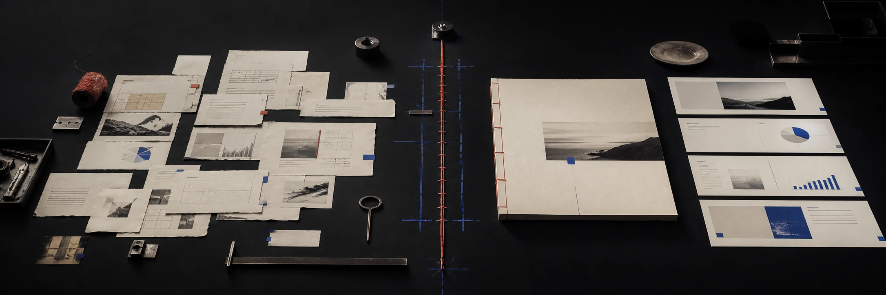
</p>

<h1 align="center">Proposal Skill V2</h1>

<p align="center">
  <strong>Take an idea all the way to a proposal you can present, verify and perform live.</strong><br>
  A governed proposal production &amp; presentation system for AI agents: strategy, manuscript, visuals, review, delivery and an offline HTML presenter stage—each gate owned by a person and checked by a script.
</p>

<p align="center">
  
  
  
  
  
  
  
</p>

<p align="center">
  <a href="#showcase">Showcase Video</a> &nbsp;·&nbsp;
  <a href="#overview">Overview</a> &nbsp;·&nbsp;
  <a href="#presenter">Offline HTML Presenter</a> &nbsp;·&nbsp;
  <a href="#whats-new">Core Studios</a> &nbsp;·&nbsp;
  <a href="#pipeline">Pipeline &amp; Gates</a> &nbsp;·&nbsp;
  <a href="#quickstart">Quick Start</a> &nbsp;·&nbsp;
  <a href="#runtime">Runtime Tiers</a> &nbsp;·&nbsp;
  <a href="#license">License</a>
</p>

---

<a id="showcase"></a>

## Showcase Video: From Grounded Drafts to a Living Offline HTML Stage

### 42 seconds · Offline HTML presenter &amp; tiered motion showcase

<p align="center">
  <a href="https://github.com/chenxupeng1990-eng/qifei-proposal-skill/blob/codex/qifei-proposal-base/docs/readme-assets/motion-showcase-github.mp4">
    
  </a>
</p>

<p align="center">
  <sub>
    <strong>42.8 seconds · 1080p · Instrumental soundtrack</strong> &nbsp;·&nbsp;
    <a href="docs/readme-assets/motion-showcase-github.mp4">Preview / Download full MP4 (8.2 MB)</a><br>
    Real case excerpt: 73-slide English commercial deck · 25 emotion-matched motion slides · compiled into <strong>1 offline HTML file</strong> (visual reference only)
  </sub>
</p>

<table>
  <tr>
    <td width="33.3%">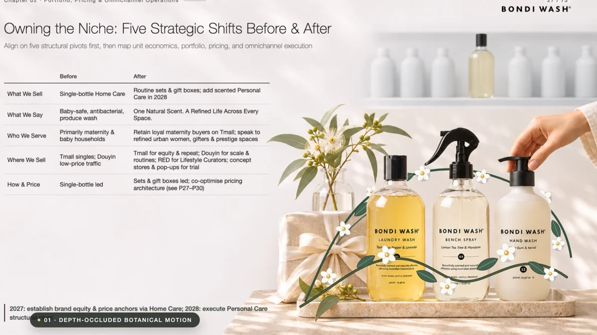</td>
    <td width="33.3%">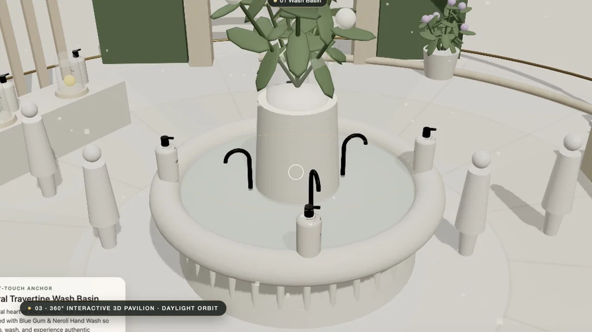</td>
    <td width="33.3%">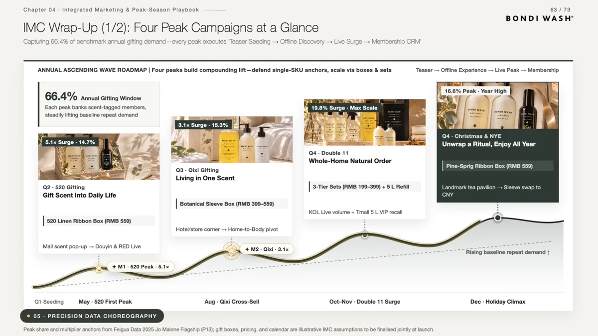</td>
  </tr>
  <tr>
    <td align="center"><sub><strong>Depth-Occluded Motion</strong><br>Locked official packaging, zero distortion</sub></td>
    <td align="center"><sub><strong>Offline 360° 3D Pavilion</strong><br>Interactive Three.js space, zero cloud</sub></td>
    <td align="center"><sub><strong>Precision Data Cues</strong><br>No flashy gimmicks—eyes locked on numbers</sub></td>
  </tr>
</table>

<details>
<summary><strong>80 seconds · Full end-to-end production flow (Draft Studio → Box Review → Gated Export)</strong></summary>

<br>

https://github.com/user-attachments/assets/967b7514-1410-44d5-ad18-003d6258f496

80 seconds · 1080p · [Download the original 80s flow MP4](docs/readme-assets/intro-github.mp4)

</details>

---

<a id="overview"></a>

## Overview

Most slide skills optimise the final step: pouring existing text into a template.

**Proposal Skill V2 governs the whole chain**: understanding source material, forming a point of view, writing the manuscript, locking a visual language, producing pages, absorbing review comments, verifying delivery, and—when presenting live—compiling the finished deck into an **offline HTML presenter stage**. The agent drives execution, the Owner makes the calls, and scripts enforce every boundary.

> **Strategy sets the ceiling. Quality gates protect the floor. The presenter stage carries the final 10% in the room.**

### How it differs

| Dimension | Typical slide skill | Proposal Skill V2 |
|---|---|---|
| **Starting point** | Formats as soon as text arrives | Settles audience, decision goal, stance and core tension first |
| **Structure** | Generates slides in isolation | Compiles a strategy spine, chapter interfaces and page-level argument chains |
| **Visuals** | Relies on a rigid template | Renders real Image2 directions first, locks `DESIGN.md`, selects best carrier per page |
| **Sign-off** | Agent decides it "looks fine" | Ties every approval to an object, version and screenshot hash—Owner only |
| **Revisions** | Feedback scattered across chat | Comments anchor directly to manuscript text and 1920×1080 page boxes |
| **Continuity** | Starts every deck from scratch | Distils Owner judgement into a 3-layer memory box loaded automatically next time |
| **Live delivery** | Stops at a static PPTX | Optional single-file offline HTML presenter: tiered motion, ZH/EN toggle, dual-screen console |

### Recent work &amp; direction calibration

Anonymised page thumbnails from recent decks across nutrition, dermocosmetics, market strategy and brand visual systems (visual references only):

<table>
  <tr>
    <td width="50%">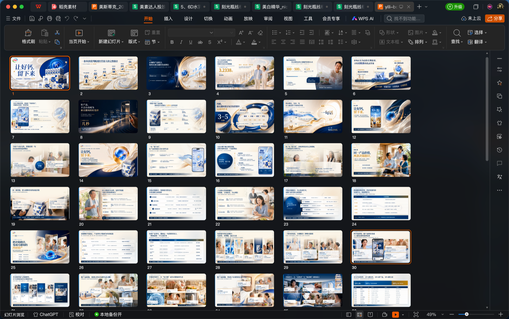</td>
    <td width="50%">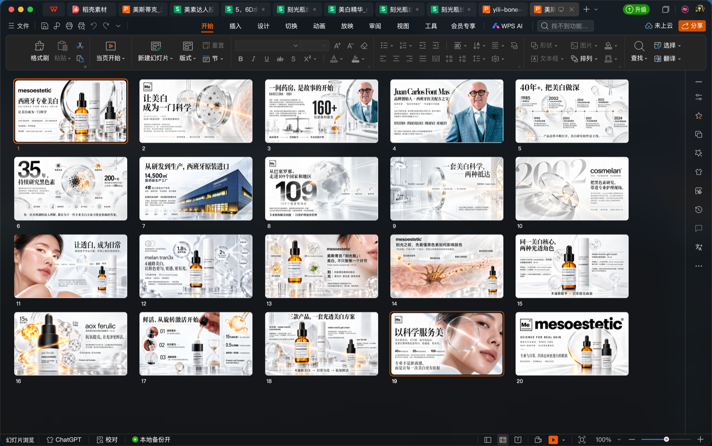</td>
  </tr>
  <tr>
    <td align="center"><sub>Nutrition &amp; wellness</sub></td>
    <td align="center"><sub>Dermocosmetics</sub></td>
  </tr>
  <tr>
    <td width="50%">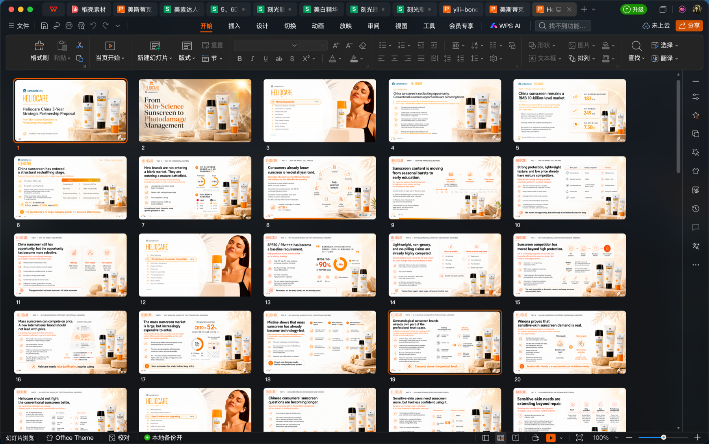</td>
    <td width="50%">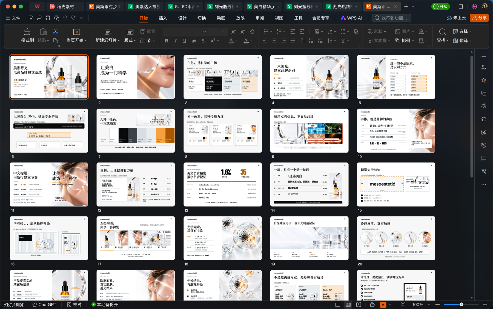</td>
  </tr>
  <tr>
    <td align="center"><sub>Market strategy</sub></td>
    <td align="center"><sub>Brand visual system</sub></td>
  </tr>
</table>

The same content is never forced into a single template. Real Image2 samples establish 2–3 distinct visual directions; once the Owner chooses one, it is locked as `DESIGN.md` before page production begins:

<table>
  <tr>
    <td width="33.3%"></td>
    <td width="33.3%"></td>
    <td width="33.3%"></td>
  </tr>
  <tr>
    <td align="center"><sub>Editorial Intelligence</sub></td>
    <td align="center"><sub>Precision Control</sub></td>
    <td align="center"><sub>Strategy Engine + Quality Gate</sub></td>
  </tr>
</table>

---

<a id="presenter"></a>

## Offline HTML Presenter &amp; Tiered Motion (Optional Delivery)

Once every page is approved, speaker notes are aligned and final checks pass, Owners who choose **HTML as their live presentation deliverable** activate [`references/presenter-html-and-motion.md`](skills/qifei-proposal-v2/references/presenter-html-and-motion.md) and compile a **100% offline single-file presenter stage** via [`scripts/build_presenter_html.py`](skills/qifei-proposal-v2/scripts/build_presenter_html.py). Motion is strictly an enhancement layer—it never alters frozen copy, numbers or product packaging.

<table>
  <tr>
    <td width="50%">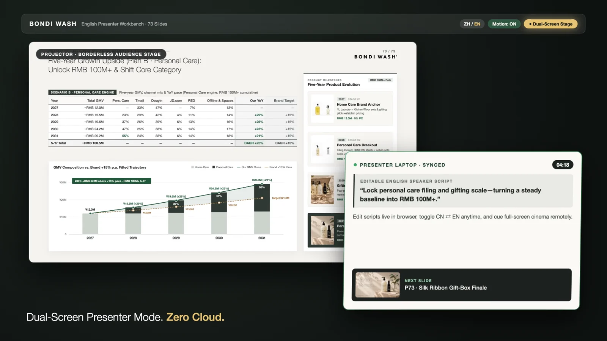</td>
    <td width="50%"></td>
  </tr>
  <tr>
    <td align="center"><sub><strong>Dual-Screen Presenter Mode (native file://)</strong><br>Borderless slides on the projector; next-slide preview, timer &amp; editable bilingual notes on your laptop</sub></td>
    <td align="center"><sub><strong>Emotion-Matched Motion Choreography</strong><br>Cinema video, interactive portals, 3D spaces &amp; data focus—all inside one local HTML file</sub></td>
  </tr>
</table>

### Motion Tiers &amp; Anti-Slop Guardrails

| Tier | Target slides | Role &amp; standard execution | Hard boundaries |
|---|---|---|---|
| **Base** | Hero / Ending / Chapter dividers / Page transitions | 6–8s locked-camera cinema video + crisp vector title overlay; subtle chapter sheen; 200–340ms transitions | Text is never burned into video; no bouncing, spinning or cheap slide wipes |
| **Tier A** | Restrained multi-column strategy, timeline &amp; framework slides | Subtle brand-motif threads connecting columns to ease reading fatigue | Zero copy overlap; no flashing or heavy contrast blocks |
| **Tier B** | Market sizing, pricing, channel &amp; financial models | Progressive curve reveals, inflection starbursts &amp; delta highlights to anchor key numbers | **No gimmicky VFX**; zero distortion of data scales or coordinates |
| **Tier C** | Emotional &amp; marketing peaks flagged in the manuscript | Ambient living video insets, depth-occluded cutouts, interactive live portals, offline 3D pavilions | Must serve a named speaking beat; otherwise demote to Tier A or static |

- **Pacing Guardrail**: `build_presenter_html.py` scans consecutive static runs across the final slide order—warning at `12–19` static slides and flagging `≥ 20` slides for pacing relief so long decks never lose the room.
- **Six Aesthetic &amp; Engineering Constraints**: palette locked to `design-tokens.json`, restrained cubic-bezier physics, one focal point per slide, no hand-drawn low-taste figurative Canvas art, print-ready resting frames, and zero invisible pointer-blocking layers.
- **Boardroom Safety Net**: press `V` anytime to drop instantly to 100% static high-res slides; zero external URLs, zero cloud services, double-click ready.

```bash
# Build a single-file offline bilingual presenter stage from a manifest JSON (editable notes on by default; pass --no-edit-notes for read-only)
python3 skills/qifei-proposal-v2/scripts/build_presenter_html.py \
  --manifest <deck-spec.json> --langs zh,en --out exports/presenter.html
```

---

<a id="whats-new"></a>

## Core Studios &amp; Governance System

> Note: the draft studio, design review and memory box interfaces below were originally authored for Chinese-language workflows, while the HTML presenter stage supports single-language or full bilingual `ZH / EN` switching.

### 01 · Proposal draft studio

The single source of truth for the manuscript. Read, edit in place and comment on selected text in the browser; direct agent edits sync within half a second. Chapter confirmations record per-page content fingerprints, so any later edit automatically re-opens that chapter for confirmation.

<p align="center">
  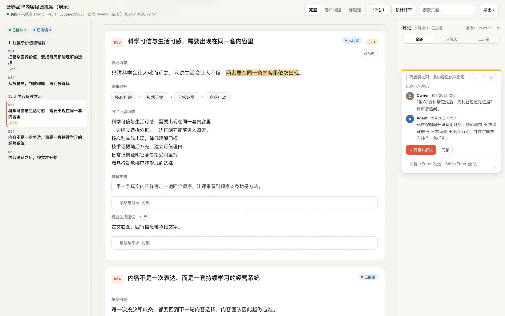
</p>

- Includes **Full / Client / Title-Chain / Wireframe** views with intact multi-column data tables.
- Threaded resolution: Owner comments → agent answers via `draft_studio.py reply` → Owner resolves in one click; decided notes stay visible as a decision trail.
- `serve --detach` keeps the studio alive after the agent's turn; no Feishu account required (Feishu remains optional at project init).

### 02 · Design review: box comments on rendered pages

During page production, the Owner draws a box directly on the rendered 16:9 slide and leaves a note—no screenshot annotations or manual JSON exports.

<p align="center">
  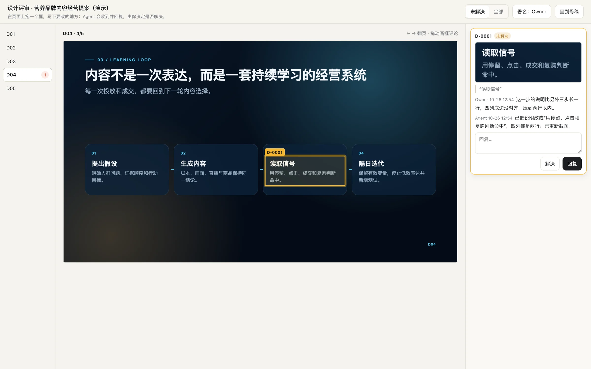
</p>

- Automatically captures page id, screenshot hash, 1920×1080 coordinates, enclosed text and region crop.
- Only the Owner can resolve comments; slides with open design comments cannot enter the assembly-ready library.

### 03 · Three-layer proposal memory box

Owner judgement carries across projects in three layers: **Owner preferences / Playbook / Project memory**. At each phase transition, the agent proposes candidates grounded in real comment and edit signals; accepted entries auto-load at future phases with read-receipt verification.

<p align="center">
  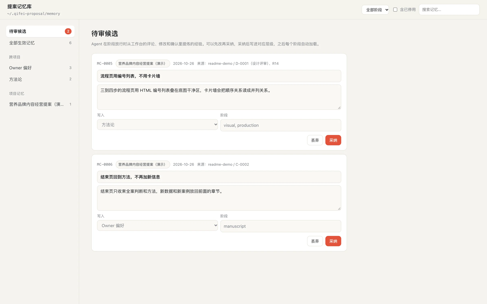
</p>

- Two commands for the agent: `proposal_memory.py note` to record live corrections, and `proposal_memory.py advance --to <phase>` to distil signals and load the next phase's memory. Can be toggled off globally with `proposal_memory.py off`.

### 04 · Hard quality gates

| Check | What it catches |
|---|---|
| **Approver check** | Approvals must come from the Owner; agents cannot self-approve or waive errors |
| **`DESIGN.md` content check** | Specs with headings but missing concrete numbers (grid, type scale, logo slot, safe zones) |
| **On-screen caution lint** | Internal hedging ("does not represent", "for reference only") leaking onto client slides |
| **Line-by-line text parity** | Missing, extra or altered copy between frozen manuscript, HTML slides and PPTX |
| **Measured layout QA** | Orphan last lines, overflow, text over busy texture, drifted logos or overlapping keepouts |
| **Independent visual review** | A second agent reviews every slide adversarially, bound to screenshot hashes |
| **Final check &amp; pacing scan** | Page order, typos and speaker notes alignment; static-run scan when HTML motion is enabled |

Full changelog in [`CHANGELOG.md`](CHANGELOG.md).

---

<a id="pipeline"></a>

## Governed Production Pipeline

```text
Idea / brief / scattered source material
   │
   ├─ 01 Decision interview ····· audience, goal, stance, core tension (grill-me-lite)
   ├─ 02 Strategy spine ········· thesis, chapter interfaces, argument order
   ├─ 03 Manuscript ············· whole chapters → studio comments → Owner confirms each chapter
   ├─ 04 Full-draft review ······ one independent pass: logic, page splits, leaked hedging
   ├─    Content freeze
   ├─ 05 Visual direction ······· real Image2 samples → Owner picks → DESIGN.md + tokens
   ├─ 06 Design calibration ····· master pages, shared type scale, reviewed text-on-image samples
   ├─ 07 Page production ········ best carrier per page → full-page Image2 + HTML text (or image_full)
   ├─    Design review ·········· box comments → agent fixes → Owner resolves → assembly library
   ├─    Independent review ····· measured layout QA + second agent slide-by-slide check
   ├─ 08 Notes & final check ···· speaker notes against final order + low-level proofread
   └─    Multi-format export ···· PNG / Vector PDF / Semi-editable PPTX / Offline HTML Presenter
```

| Phase | Script checks | Owner confirms |
|---|---|---|
| **Manuscript** | `proposal-draft-v2` schema, caution lint, title chain, revision hashes | Each chapter / page |
| **Full-draft review** | Independent report presence and id | Content freeze |
| **Visuals &amp; calibration** | Real assets, official product references, `DESIGN.md` &amp; token values | Direction &amp; calibration |
| **Page production** | Page contract, build id, exact on-screen text match, zero open comments | Each slide into library |
| **Visual review** | Zero measured layout issues; full-deck independent review with hashes | — |
| **Export &amp; stage** | Final check, speaker-note order, PPTX parity; motion plan &amp; pacing scan | Motion plan &amp; final delivery |

### Three task modes

| Mode | Use it for | What remains controlled |
|---|---|---|
| `full_deck` | 0–1 commercial proposals, brand books or keynotes | Full strategy, review, freeze, visual calibration, notes and export |
| `inherited_module` | Adding or replacing sections in an existing governed deck | Parent strategy and design tokens, module interfaces and slide QA |
| `standalone_module` | Single slide or 2–8 slide module | Lightweight brief, core claim, visual baseline, review loop and export |

---

<a id="onboarding"></a>

## First run: the illustrated guide

After installing, tell the agent “use the proposal skill to build a proposal”. It first explains the eight steps and the five where you sign off, then opens an illustrated guide: what the agent does and what you decide at each step, with screens drawn after the real studio. The guide is a single bilingual HTML file at [`skills/qifei-proposal-v2/assets/guide/onboarding.html`](skills/qifei-proposal-v2/assets/guide/onboarding.html); download it and double-click to open.

<p align="center">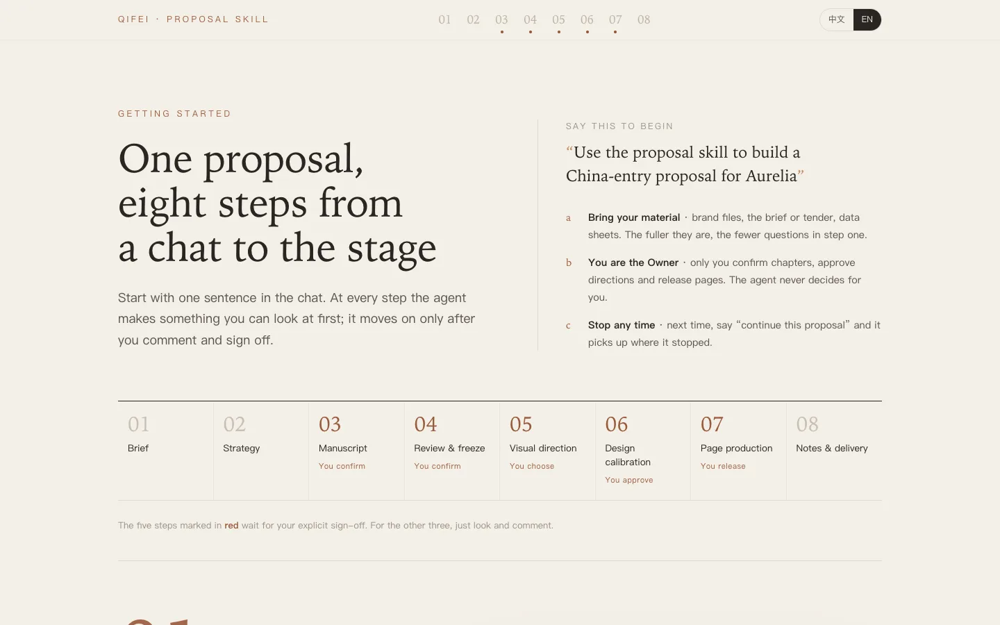 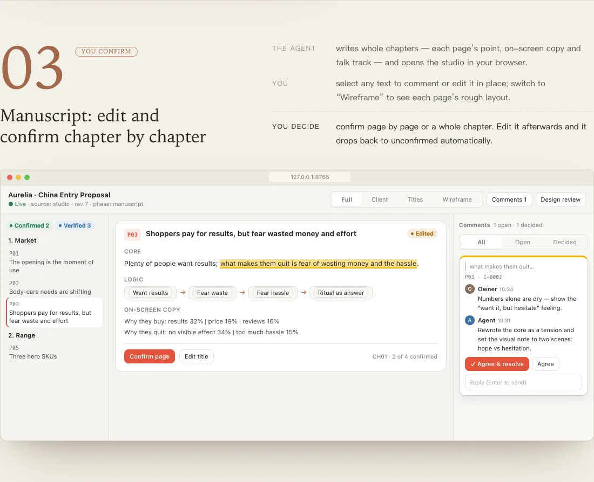</p>

<a id="quickstart"></a>

## Quick Start

### 1. Clone and bootstrap

```bash
git clone https://github.com/chenxupeng1990-eng/qifei-proposal-skill.git
cd qifei-proposal-skill
python3 scripts/bootstrap.py --suite v2
```

On macOS double-click [`scripts/install_v2.command`](scripts/install_v2.command); on Windows run [`scripts/install_v2.ps1`](scripts/install_v2.ps1).

### 2. Install the skill suite

```bash
python3 scripts/install_skills.py --suite v2
```

Installs to `~/.codex/skills` by default (stops if a folder already exists; pass `--force` to overwrite). Restart your agent and invoke `$qifei-proposal-v2` (or `/qifei-proposal-v2`).

### 3. Doctor, initialise and open studios

```bash
# Detect real local & agent capabilities
python3 skills/qifei-proposal-v2/scripts/doctor.py --task-mode full_deck --json

# Create a full proposal project
python3 skills/qifei-proposal-v2/scripts/init_project.py \
  --project <project-dir> --name <project-name> --owner <owner> --task-mode full_deck

# Launch draft studio (including /design box review) and memory box
python3 skills/qifei-proposal-v2/scripts/draft_studio.py serve <project-dir> --detach
python3 skills/qifei-proposal-v2/scripts/memory_box.py
```

On Windows replace `python3` with `py -3` or `python` (run self-test via `python scripts/self_test.py`), and quote paths containing spaces or non-ASCII characters.

### 4. Updates

When a new release lands, the agent alerts you at task start (at most once a day). Say "update the proposal skill" to upgrade safely (projects and memory are untouched; failed self-checks roll back automatically), or run directly:

```bash
python3 ~/.codex/skills/qifei-proposal-v2/scripts/update_skill.py run
python3 ~/.codex/skills/qifei-proposal-v2/scripts/update_skill.py off
```

---

<a id="runtime"></a>

## Runtime Tiers &amp; Suite

Not locked to any single model or subscription. `doctor.py` probes real local and declared agent capabilities and never downgrades silently:

| Tier | What it supports |
|---|---|
| `codex_full` | Built-in image gen, vision, local rendering &amp; comments: end-to-end production |
| `api_full` | Any agent with files, shell, image API, vision &amp; local runtime: full production |
| `local_production` | Rendering, review &amp; export; cannot pass visual direction gate without formal image gen |
| `content_only` | Strategy, manuscript, page routes &amp; prompt packages without faking visual delivery |

| Skill | Role | Install |
|---|---|---|
| `qifei-proposal-v2` | Main orchestrator: phases, gates, draft studio, memory box, offline HTML presenter | Required |
| `grill-me-lite` | One-question-at-a-time decision interview | Required |
| `proposal-ppt-production` | Carrier selection, visual production &amp; assembly | Recommended |
| `ppt-html-calibration-editor` | Pixel-level calibration editor for 16:9 HTML slides | Optional |

### Delivery formats

- **Base delivery**: approved PNGs, selectable vector PDF (`exports/proposal-vector.pdf`), and image-based PPTX.
- **Enhanced delivery**: semi-editable PPTX with native PowerPoint text layers checked line by line against the manuscript.
- **Visual-showcase route**: whole-page image generation (`render_route: image_full`) with text verification for brand books and monographs.
- **Offline HTML presenter (optional)**: single-file offline presentation, bilingual switching, live-editable speaker notes, dual-screen console and tiered motion.

<details>
<summary><strong>Governance rules</strong></summary>

- Accuracy is the boundary; a point of view that moves a decision is the goal.
- On screen: claims, evidence and sources only. Internal caveats belong in speaker notes or the evidence ledger.
- Strategy compiles into chapter interfaces, then page argument chains; each chapter's output feeds the next.
- Whole chapters are generated at once after page chains are confirmed, then reviewed page by page.
- One independent full-draft review runs after content confirmation and never re-litigates settled Owner calls.
- Real image assets are required in direction calibration; default route is full-page Image2 base + HTML text layer.
- Speaker notes are written once against final slide numbers; HTML motion layers only after final check passes.

</details>

<details>
<summary><strong>Company facts &amp; project isolation</strong></summary>

`company-facts.json` ships as an empty template. Client briefs, brand assets, review boards and final exports stay inside each private project directory; memories live in `~/.qifei-proposal/memory/`. This repository contains only reusable rules, templates, scripts, tests and anonymised demos.

</details>

<details>
<summary><strong>Repository layout</strong></summary>

```text
skills/qifei-proposal-v2/               Main skill: phase packs, references, templates, scripts, tests
  ├─ references/presenter-html-and-motion.md  Offline HTML presenter, dual-screen & motion spec
  ├─ scripts/draft_studio.py            Draft studio & /design box-comment review
  ├─ scripts/memory_box.py              Three-layer proposal memory box
  ├─ scripts/build_presenter_html.py    Single-file offline HTML presenter builder & pacing scan
  └─ scripts/validate_project.py        Phase & delivery gates
skills/grill-me-lite/                   Decision interview
skills/proposal-ppt-production/         Page production & assembly
skills/ppt-html-calibration-editor/     HTML calibration editor
demo/visual-sample/                     Anonymised visual demo
scripts/                                Install, bootstrap & release self-test
docs/readme-assets/                     Videos, animated reel & studio screenshots
```

</details>

---

## Status

Active development lives on [`codex/qifei-proposal-base`](https://github.com/chenxupeng1990-eng/qifei-proposal-skill/tree/codex/qifei-proposal-base) (baseline `v0.3.2`, now including the upcoming `v0.3.3` offline HTML presenter, native dual-screen stage, tiered motion spec and pacing guardrail). All **244 Python tests (239 core + 5 installer)** pass. Real-world feedback and issues are welcome.

<a id="license"></a>

## License

This repository is **not unrestricted open source and does not grant commercial usage rights**. By default it is licensed only for personal learning, research, testing and non-commercial internal evaluation.

- Full terms in [`LICENSE`](LICENSE) (PolyForm Noncommercial License 1.0.0).
- Commercial use, team deployment, paid client delivery, redistribution or closed-source integration require prior written commercial authorisation from the author.
