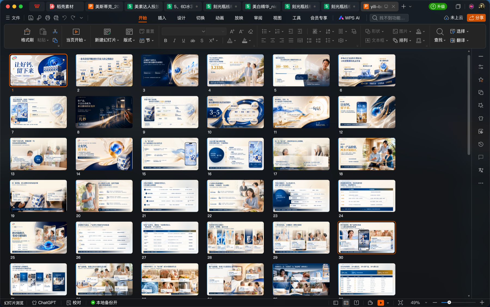
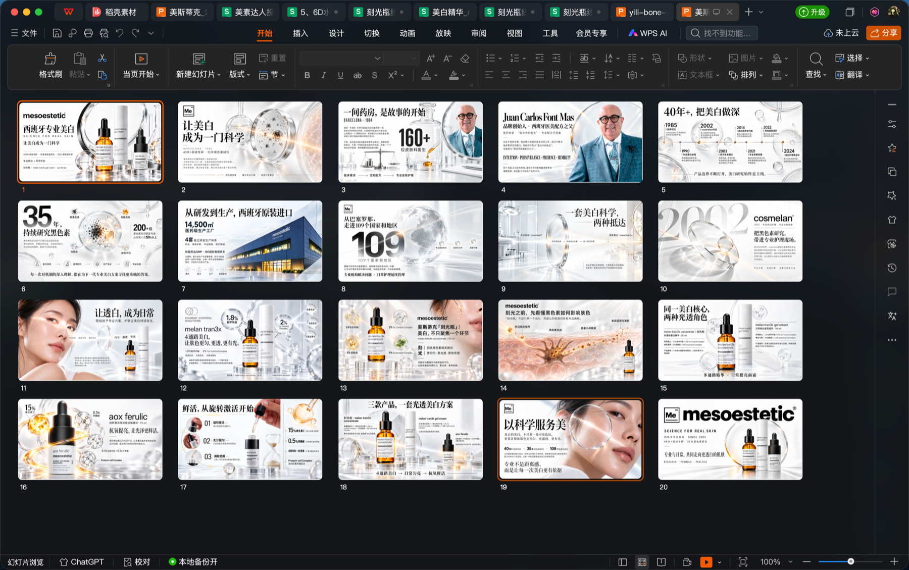
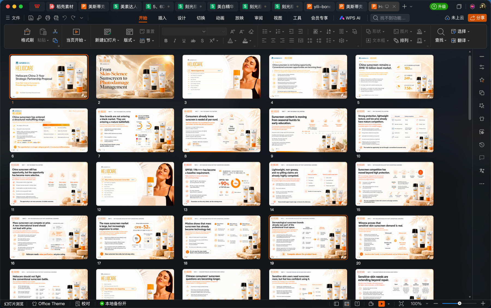
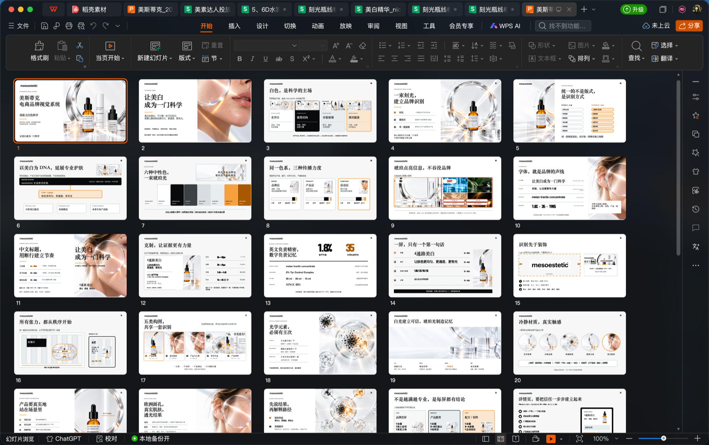
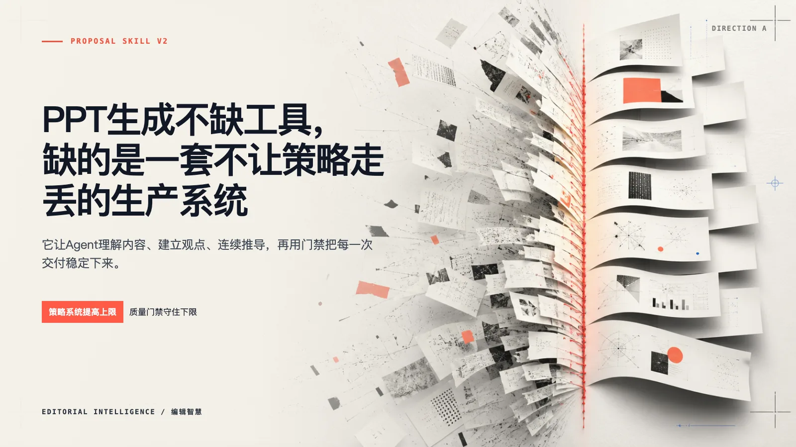
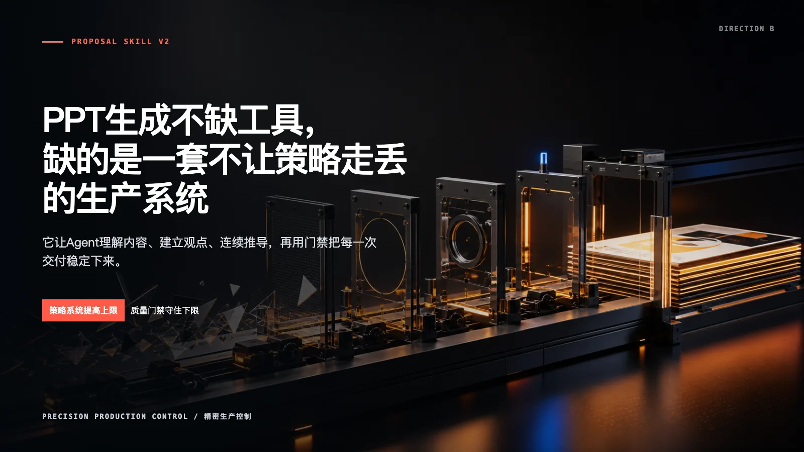
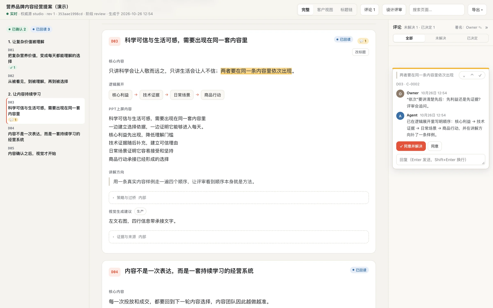
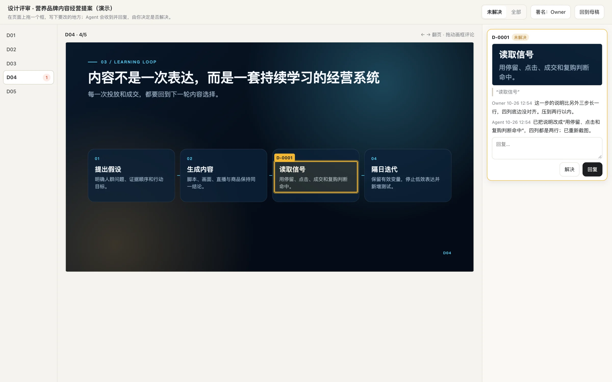
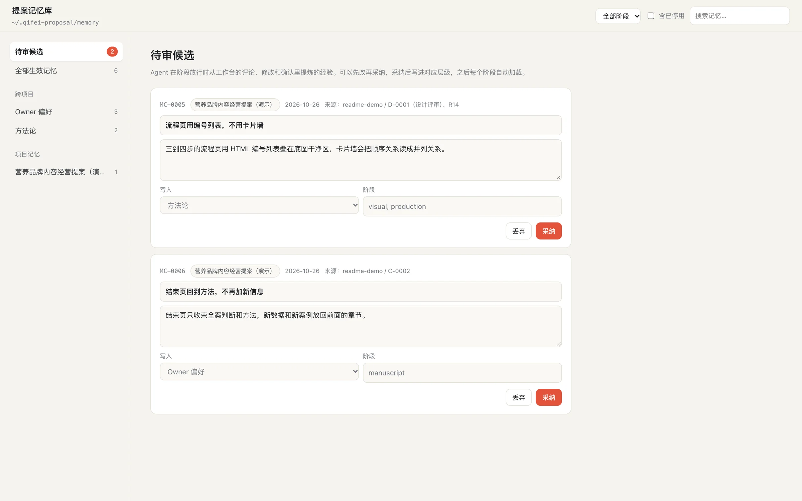

<p align="center">
  <strong>简体中文</strong> · <a href="README.en.md">English</a>
</p>

<p align="center">
  
</p>

<h1 align="center">Proposal Skill V2</h1>

<p align="center">
  <strong>把一个想法，推进成一份可呈现、可验证、可交付的提案。</strong><br>
  一套给 AI Agent 用的提案生产系统：策略、母稿、视觉、评审、交付，每一步都有人确认、有机器把关。
</p>

<p align="center">
  
  
  
  
  
  
</p>

<p align="center">
  <a href="#overview">它是什么</a> ·
  <a href="#whats-new">v0.3 新能力</a> ·
  <a href="#pipeline">生产链</a> ·
  <a href="#gates">门禁</a> ·
  <a href="#quickstart">快速开始</a> ·
  <a href="#runtime">运行档位</a> ·
  <a href="#license">授权</a>
</p>

---

<a id="overview"></a>

## 它是什么

大多数 PPT Skill 优化的是最后一步：把已有文字放进模板。

Proposal Skill V2 管的是整条链路：理解资料、建立观点、写成母稿、锁定视觉语言、逐页生产、吸收评论、核对交付。Agent 负责推进，Owner 负责拍板，脚本负责把关，三者的边界写在流程里，而不是靠提示词约定。

> **策略系统决定作品上限，质量门禁守住交付下限。**

### 80 秒看完整流程

https://github.com/user-attachments/assets/967b7514-1410-44d5-ad18-003d6258f496

80 秒 · 1080p · [下载 MP4 原文件](docs/readme-assets/intro-github.mp4)

### 先看成品

以下是近期真实提案的页面缩略图（已脱敏），覆盖营养健康、医美护肤、市场策略和品牌视觉系统。它们只作为视觉参考，不是本仓库的客户资料或事实库。

<table>
  <tr>
    <td width="50%"></td>
    <td width="50%"></td>
  </tr>
  <tr>
    <td align="center"><sub>营养健康</sub></td>
    <td align="center"><sub>医美护肤</sub></td>
  </tr>
  <tr>
    <td width="50%"></td>
    <td width="50%"></td>
  </tr>
  <tr>
    <td align="center"><sub>市场策略</sub></td>
    <td align="center"><sub>品牌视觉系统</sub></td>
  </tr>
</table>

同一份内容不会直接套模板。系统先用真实的 Image2 样图做出 2–3 个视觉方向，由 Owner 选定后固定成 `DESIGN.md`，再按它逐页生产。

<table>
  <tr>
    <td width="33%"></td>
    <td width="33%"></td>
    <td width="33%"></td>
  </tr>
  <tr>
    <td align="center"><sub>Editorial Intelligence</sub></td>
    <td align="center"><sub>Precision Control</sub></td>
    <td align="center"><sub>Strategy Engine + Quality Gate</sub></td>
  </tr>
</table>

### 和普通 PPT Skill 的区别

| 常见 PPT Skill | Proposal Skill V2 |
|---|---|
| 收到文字就开始排版 | 先确认受众、决策目标、立场和核心矛盾 |
| 一页一页独立生成 | 先建立总策略、章节接口和页面论证链 |
| 用模板保证表面统一 | 用 `DESIGN.md`、母版和逐页载体判断保证表达统一 |
| Agent 自己判断“看起来可以” | 每一道批准绑定对象、版本和证据，只认 Owner |
| 评论散落在聊天记录里 | 评论落在母稿和页面的具体位置，Agent 回复，Owner 决定 |
| 每个项目从零开始 | Owner 的判断沉淀成记忆，下一个项目自动带上 |
| 导出 PPT 就算完成 | 页序、上屏文字、版面和讲稿核对通过才能导出 |

---

<a id="whats-new"></a>

## v0.3 新能力

v0.3 把协作从飞书搬到本地，并用一次完整的模拟项目（Agent 全程执行、人扮演 Owner）检验了每一道门禁，把暴露出的缺口逐条补上。

### 提案母稿工作台

母稿的唯一权威源。在浏览器里阅读、就地编辑、选中文字评论；Agent 直接改母稿文件，页面约半秒内同步。Owner 逐章确认，确认会记下每一页的内容指纹，之后任何修改都会让这一章自动退回待确认。

<p align="center">
  
</p>

- 三种视图：完整、客户视图、只读标题链。
- 评论线程：Owner 提问，Agent 用 `draft_studio.py reply` 回复，Owner 一键“同意并解决”；已决定的意见保留为决策记录。
- `serve --detach` 让工作台在 Agent 一轮结束后继续运行，链接随时可开。
- 不依赖飞书账号；飞书仍可在项目启动时选为权威源（[飞书用法教程](https://my.feishu.cn/docx/AegvdkYQ8odUetxOo8bcOCILn64)）。

### 设计评审：在页面上框选评论

页面生产阶段，Owner 直接在渲染好的页面上拖一个框写意见，不再截图、导出 JSON 转交。

<p align="center">
  
</p>

- 每条评论自动记录：页面、截图哈希、1920×1080 坐标、框住的文字和区域截图。
- Agent 用 `design_review.py list` 读取、改页、`reply` 回复；页面重新截图后，旧评论标“页面已更新”。
- 只有 Owner 能解决；还有未解决设计评论的页面进不了拼装准备库。

### 提案记忆库

Owner 的判断跨项目沉淀，分三层：Owner 偏好、方法论、项目记忆。Agent 在每次阶段放行前，从评论、修改和确认里提炼候选；Owner 在记忆库里采纳、改写或丢弃。之后每个阶段开工时自动加载。

<p align="center">
  
</p>

- Agent 只需两个命令：Owner 在对话里给出更正时用 `proposal_memory.py note` 当场记下；换阶段时用 `proposal_memory.py advance --to <新阶段>`，一次完成汇总信号、提示写候选、读取新阶段记忆。
- 不需要时可以全局关闭：`proposal_memory.py off`，或在记忆库顶部取消“启用记忆”。
- 记忆读取不靠提示词：`doctor.py` 和 `validate_project.py` 自动带出记忆并检查读取回执；离开阶段前没有汇总信号，校验不放行。

### 更硬的门禁

| 新增检查 | 拦住什么 |
|---|---|
| 批准人校验 | 门禁批准必须来自 Owner；Agent 不能自己批准，也不能自己豁免校验错误 |
| `DESIGN.md` 内容校验 | 只有标题没有数值的设计规范：网格与安全区、字号下限与拆页、文字区比例、文字层组件、分批规则、母版清单、QA 清单 |
| 上屏审慎用语拦截 | “不等于 / 不代表 / 尚未”这类内部审慎说明出现在客户看到的页面上 |
| 上屏文字逐行比对 | 页面或 PPTX 上的字与冻结母稿不一致：缺字、多字都报错 |
| 版面实测 | 孤字尾行、文字溢出越界、文字压在纹理上、左缘差几像素，由脚本在真实渲染上量出 |
| 独立视觉审查 | 由另一个 Agent 逐页对抗审查，报告绑定每页截图哈希 |
| 最终核对 | 导出前只查低级错误：页序、上屏文字、版面、错别字通读 |

完整改动见 [`CHANGELOG.md`](CHANGELOG.md)。

---

<a id="pipeline"></a>

## 一条从想法到成品的生产链

```text
想法 / 标书 / 资料
   │
   ├─ 关键决策访谈 ········ 受众、目标、立场、核心矛盾
   ├─ 策略主轴 ············ 核心命题、章节接口、论证顺序
   ├─ 母稿成稿 ············ 整章生成 → 工作台评论修改 → Owner 逐章确认
   ├─ 全稿审查 ············ 独立 Agent 一次性检查逻辑、表达、拆页、审慎语言外露
   ├─ 内容冻结
   ├─ 视觉方向 ············ 真实 Image2 样图 → Owner 选择 → DESIGN.md
   ├─ 设计校准 ············ 母版页、文字层组件、带文字的整页评审
   ├─ 页面生产 ············ 逐页选载体 → 整页 Image2 底图 + HTML 文字层 → 分批生产
   ├─ 设计评审 ············ 框选评论 → Agent 修改 → Owner 解决 → 进入拼装准备库
   ├─ 独立视觉审查 ········ 版面实测 + 另一个 Agent 逐页对抗审查
   ├─ 讲稿 ················ 按最终页码一次生成
   └─ 最终核对 → 导出 ····· PNG / PDF / PPTX
```

每个阶段回答三个问题：要做出什么可检查的对象？谁可以确认它？哪些条件不满足时流程不能继续？每个阶段开工时，Agent 自动加载这一阶段相关的记忆。

<a id="gates"></a>

## 门禁

门禁分两类：机器能判断的由脚本检查，需要判断力的由 Owner 确认。机器通过不等于 Owner 批准。

| 阶段 | 脚本检查 | Owner 确认 |
|---|---|---|
| 母稿 | 统一母稿格式、上屏审慎用语、标题链、修订与登记哈希 | 逐章确认 |
| 全稿审查 | 独立 Agent 报告与编号 | 内容冻结 |
| 视觉方向与校准 | 真实图像资产、品牌来源、`DESIGN.md` 内容级校验 | 选定方向、批准校准 |
| 页面生产 | 页面合同、构建身份、上屏文字逐行一致、无未解决设计评论 | 逐页确认进入拼装准备库 |
| 视觉审查 | 版面实测零问题、独立审查覆盖每页且哈希一致 | — |
| 导出 | 最终核对通过、讲稿页序一致、PPTX 文字再次比对 | 最终交付 |

阶段之间还有一道记忆门禁：离开阶段前要汇总记忆信号，记忆有更新而未读取时不放行。

## 不只是长提案

| 模式 | 适用任务 | 保留的核心控制 |
|---|---|---|
| `full_deck` | 0–1 完整提案、报告或演示 | 完整策略、全稿审查、内容冻结、视觉方向、讲稿与导出 |
| `inherited_module` | 向已有受控 PPT 增加或替换模块 | 继承父项目策略与设计，只验证模块接口和页面质量 |
| `standalone_module` | 独立单页或 2–8 页内容模块 | 轻量简报、模块判断、视觉基线、页面回环与导出 |

---

<a id="quickstart"></a>

## 快速开始

### 1. 下载并检查环境

```bash
git clone https://github.com/chenxupeng1990-eng/qifei-proposal-skill.git
cd qifei-proposal-skill
python3 scripts/bootstrap.py --suite v2
```

macOS 可以直接双击 [`scripts/install_v2.command`](scripts/install_v2.command)，Windows 使用 [`scripts/install_v2.ps1`](scripts/install_v2.ps1)。安装器会检查 Python、Node.js、npm 和浏览器。

### 2. 安装 Skill 套件

```bash
python3 scripts/install_skills.py --suite v2
```

默认安装到 `~/.codex/skills`；已有同名 Skill 时会停止，确认替换时加 `--force`。安装后重启 Agent，调用：

```text
$qifei-proposal-v2
```

### 3. 创建项目

```bash
# 检查当前 Agent 和本机能完成到哪一步
python3 skills/qifei-proposal-v2/scripts/doctor.py --task-mode full_deck --json

# 新建完整提案
python3 skills/qifei-proposal-v2/scripts/init_project.py \
  --project <项目目录> --name <项目名> --owner <Owner> --task-mode full_deck
```

### 4. 打开工作台和记忆库

```bash
# 母稿工作台（含 /design 设计评审页），Agent 一轮结束后继续运行
python3 skills/qifei-proposal-v2/scripts/draft_studio.py serve <项目目录> --detach

# 提案记忆库
python3 skills/qifei-proposal-v2/scripts/memory_box.py
```

Windows 中把 `python3` 换成 `py -3` 或 `python`；路径含中文或空格时加引号。

### 5. 更新

不用记命令。有新版本时，Agent 开工时会告诉你（每天最多一次）；你说“更新提案 skill”，它就帮你更新。更新只替换 skill 本身，项目文件和提案记忆不受影响；新版本自检不通过会自动退回旧版本。也可以自己运行：

```bash
python3 ~/.codex/skills/qifei-proposal-v2/scripts/update_skill.py run   # 更新
python3 ~/.codex/skills/qifei-proposal-v2/scripts/update_skill.py off   # 不再检查更新
```

<a id="runtime"></a>

## 运行档位：不绑定 Codex 订阅

Doctor 检测本机和 Agent 的真实能力，选择能做到的最高档位，不按 Agent 品牌判断。脚本看不到 Agent 自己的工具，所以生图、看图和原生评论由 Agent 声明：`doctor.py --image-provider <名称> --visual-understanding [--native-comments]`，加 `--remember` 记在本机。仍然缺的能力不会默认降级：doctor 会逐项列出补齐办法，先问用户，用户明确选择暂不补齐时才记录降级。

| 档位 | 可以完成什么 |
|---|---|
| `codex_full` | 内置图像、视觉理解、本地渲染与评论齐全，可完成完整生产 |
| `api_full` | 其他 Agent 具备文件、命令、图像 API、视觉理解和本地运行时，也可完成正式生产 |
| `local_production` | 可以渲染、评审和导出；缺正式图像能力时不能通过视觉方向门禁 |
| `content_only` | 可以完成策略、母稿、页面路由和提示词包，不冒充视觉或 PPTX 交付 |

可替换的适配器：图像生成（Codex 内置图像、OpenAI 兼容 API、自定义命令）、内容权威（工作台、飞书、继承父项目、本地 Markdown）、独立审查（独立 Agent、独立 API 调用、指定人工）。API Key 和令牌不会写进项目状态、提示词记录或日志。详见 [`task-modes-and-runtime.md`](skills/qifei-proposal-v2/references/task-modes-and-runtime.md)。

## 套件组成

| Skill | 作用 | 安装级别 |
|---|---|---|
| `qifei-proposal-v2` | 总控入口：阶段、状态、门禁、母稿工作台、记忆库 | 必装 |
| `grill-me-lite` | 一次一个问题的关键决策访谈 | 必装 |
| `proposal-ppt-production` | 页面载体选择、视觉生产与组装 | 推荐 |
| `ppt-html-calibration-editor` | 16:9 HTML 页面的精细校准 | 可选 |

## 交付与可编辑性

- **基础交付**：PNG、PDF、图片型 PPTX，优先保持已批准的视觉。
- **增强交付**：按需生成带 PowerPoint 原生文字层的半可编辑 PPTX，并与母稿逐行比对。
- **可追溯**：HTML、批准 PNG、内容哈希和项目状态共同支撑复核与再次导出。

图表、复杂 SVG 和生成图像不承诺完全原生可编辑；不同办公软件的最终渲染仍需人工复核。机器检查通过不等于视觉验收通过。

<details>
<summary><strong>核心治理规则</strong></summary>

- 准确是边界，观点和决策推动是目标；正确但没有观点的页面要退回。
- 上屏只放观点、证据和来源；边界写进措辞本身，内部审慎说明放讲稿或证据台账。
- 总策略先编译为章节接口，再编译为页面论证链；上一章的输出必须成为下一章的输入。
- 页面论证链确认后一次生成整章正文，再逐页评论和确认。
- 全部内容确认后只做一次全稿审查，不重新审判 Owner 已确认的场外决策。
- 正式视觉前必须有真实图像资产参与方向校准；默认路线是整页 Image2 底图加 HTML 文字层，每页先按内容选最佳载体，按母版生图。
- 并行只发生在页面生产；共享文件由主 Agent 持有，生产结果按波次回收复验。
- 讲稿等全部页面和最终页序确认后，按最终页码一次生成。

</details>

<details>
<summary><strong>公司资料与项目隔离</strong></summary>

默认的 `company-facts.json` 只是空模板。真实使用前，在私有项目中登记经过核准的公司事实，并为每条保留来源和对外使用状态。

客户资料、品牌资产、项目 `AGENTS.md`、评审页面和最终交付物都保存在各自的项目目录；记忆保存在 `~/.qifei-proposal/memory/`。本仓库只放通用规则、模板、脚本、测试和脱敏 Demo。

</details>

## 仓库结构

```text
skills/qifei-proposal-v2/            总控 Skill：阶段包、参考规范、模板、脚本与测试
  ├─ scripts/draft_studio.py         母稿工作台与设计评审页
  ├─ scripts/memory_box.py           提案记忆库
  └─ scripts/validate_project.py     阶段门禁
skills/grill-me-lite/                关键决策访谈
skills/proposal-ppt-production/      页面生产与组装
skills/ppt-html-calibration-editor/  HTML 校准编辑器
demo/visual-sample/                  脱敏视觉 Demo
scripts/                             安装、Bootstrap 与发布自检
docs/readme-assets/                  本页图片
```

完整阶段说明见 [`SKILL.md`](skills/qifei-proposal-v2/SKILL.md)；版本记录见 [`CHANGELOG.md`](CHANGELOG.md)。

## 当前状态

v0.3.1 已发布在 [`codex/qifei-proposal-base`](https://github.com/chenxupeng1990-eng/qifei-proposal-skill/tree/codex/qifei-proposal-base)。本仓库的 195 个 Python 测试和发布自检（`python3 scripts/self_test.py`）全部通过；母稿工作台、设计评审和记忆库都在模拟项目上用浏览器走过完整流程。欢迎用真实任务测试并反馈。

<a id="license"></a>

## 使用与授权

本仓库**不是无限制开源，也不授予商业使用权**。默认仅允许个人学习、研究、测试和非商业内部评估使用。

本仓库按 [PolyForm Noncommercial 1.0.0](LICENSE) 授权，完整条款见 [`LICENSE`](LICENSE)。商业项目、收费交付、商业服务、对外售卖、商业培训、企业部署、再分发或产品集成，需要事先取得仓库 Owner 的书面许可；除明确的书面许可外，本仓库不授予任何商业授权。
