<p align="center">
  <strong>简体中文</strong> &nbsp;·&nbsp; <a href="README.en.md">English</a>
</p>

<p align="center">
  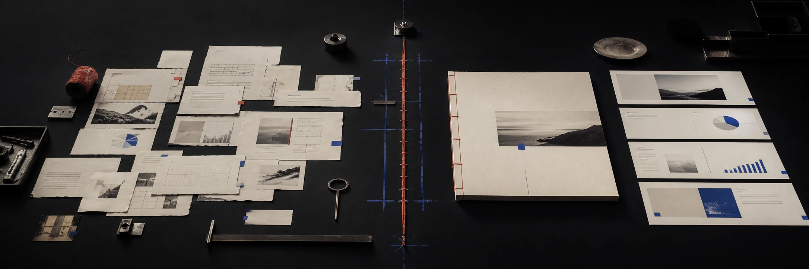
</p>

<h1 align="center">Proposal Skill V2</h1>

<p align="center">
  <strong>把一个想法，推进成一份可呈现、可验证、可直接上台演示的提案。</strong><br>
  一套给 AI Agent 用的提案生产与演播系统：策略、母稿、视觉、评审、交付与离线 HTML 讲解台，每一步都有人拍板、有脚本把关。
</p>

<p align="center">
  
  
  
  
  
  
  
</p>

<p align="center">
  <a href="#showcase">演示视频</a> &nbsp;·&nbsp;
  <a href="#overview">它是什么</a> &nbsp;·&nbsp;
  <a href="#presenter">离线 HTML 讲解台</a> &nbsp;·&nbsp;
  <a href="#whats-new">核心工作台</a> &nbsp;·&nbsp;
  <a href="#pipeline">生产链与门禁</a> &nbsp;·&nbsp;
  <a href="#quickstart">快速开始</a> &nbsp;·&nbsp;
  <a href="#runtime">运行档位</a> &nbsp;·&nbsp;
  <a href="#license">授权</a>
</p>

---

<a id="showcase"></a>

## 演示视频：从扎实母稿到「会动的离线 HTML」

### 42 秒 · 离线 HTML 讲解台与分层动效实战

<p align="center">
  <a href="https://github.com/chenxupeng1990-eng/qifei-proposal-skill/blob/codex/qifei-proposal-base/docs/readme-assets/motion-showcase-github.mp4">
    
  </a>
</p>

<p align="center">
  <sub>
    <strong>42.8 秒 · 1080p · 含器乐原声</strong> &nbsp;·&nbsp;
    <a href="docs/readme-assets/motion-showcase-github.mp4">点击预览 / 下载完整 MP4（8.2 MB）</a><br>
    真实案例节选：73 页英文商业提案 · 25 页按情绪曲线编排的分层动效 · 全部编译进 <strong>1 个离线 HTML</strong>（视觉参考，不含客户机密原稿）
  </sub>
</p>

<table>
  <tr>
    <td width="33.3%"></td>
    <td width="33.3%">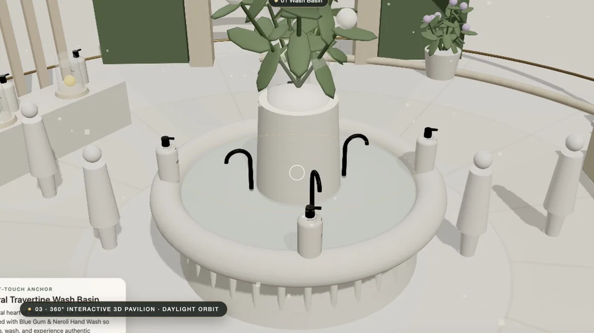</td>
    <td width="33.3%">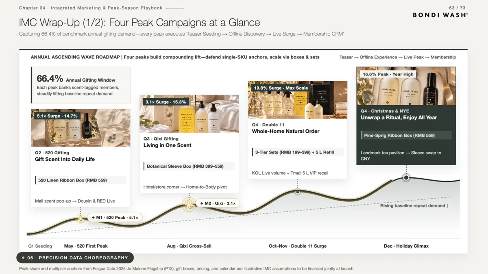</td>
  </tr>
  <tr>
    <td align="center"><sub><strong>实景前后景遮挡</strong><br>官方产品包装锁底不变形</sub></td>
    <td align="center"><sub><strong>离线 360° 3D 展厅</strong><br>Three.js 沙盘交互，零云端依赖</sub></td>
    <td align="center"><sub><strong>商业数据注意力聚焦</strong><br>不做花哨特效，锁定关键拐点</sub></td>
  </tr>
</table>

<details>
<summary><strong>80 秒 · 完整提案生产链演示（母稿工作台 → 框选评审 → 门禁导出）</strong></summary>

<br>

https://github.com/user-attachments/assets/967b7514-1410-44d5-ad18-003d6258f496

80 秒 · 1080p · [下载流程演示 MP4 原文件](docs/readme-assets/intro-github.mp4)

</details>

---

<a id="overview"></a>

## 它是什么

大多数 PPT Skill 只优化最后一步：把已有文字塞进模板。

**Proposal Skill V2 管的是整条链路**：理解资料、建立观点、写成母稿、锁定视觉语言、逐页生产、吸收评论、核对交付，以及在定稿之后把方案编译成可直接上台投屏的**离线 HTML 讲解台**。Agent 负责推进，Owner 负责拍板，脚本负责把关——三者的边界写在流程与校验里，而不是靠提示词祈祷。

> **策略系统决定作品上限，质量门禁守住交付下限，讲解台守住上台呈现的最后 10%。**

### 和普通 PPT Skill 的区别

| 维度 | 常见 PPT Skill | Proposal Skill V2 |
|---|---|---|
| **起点** | 收到文字就开始套版 | 先做决策访谈，明确受众、决策目标、立场与核心矛盾 |
| **结构** | 一页一页孤立生成 | 先编译总策略、章节接口与页面论证链，前后章硬衔接 |
| **视觉** | 靠固定模板假装统一 | 先出真实 Image2 方向样张，锁定 `DESIGN.md` 与母版逐页选载体 |
| **验收** | Agent 自己说“看起来不错” | 每一道批准绑定对象、版本与截图哈希，只认 Owner |
| **修改** | 意见散落在聊天记录里 | 评论直接锚定母稿文字与页面坐标，Agent 回复、Owner 解决 |
| **沉淀** | 每个项目从零开始 | Owner 的判断沉淀进三层记忆库，下个项目自动带入 |
| **上台演示** | 导出静态 PPTX 就算结束 | 可选编译为单文件离线 HTML 讲解台：分层动效、中英双语、双屏提词 |

### 真实提案成品与方向校准

以下是近期真实提案的脱敏页面缩略图（仅作视觉参考，非客户资料库），覆盖营养健康、医美护肤、市场策略和品牌视觉系统：

<table>
  <tr>
    <td width="50%">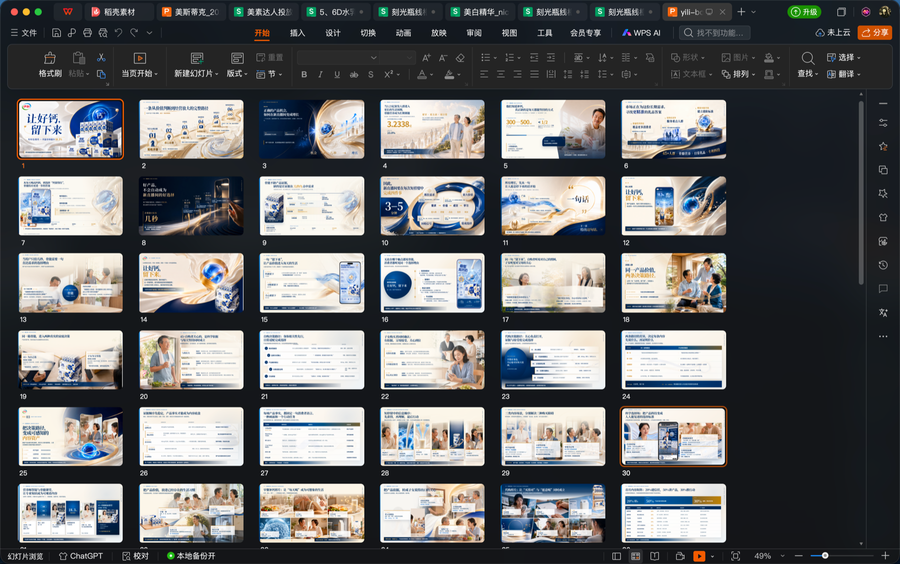</td>
    <td width="50%">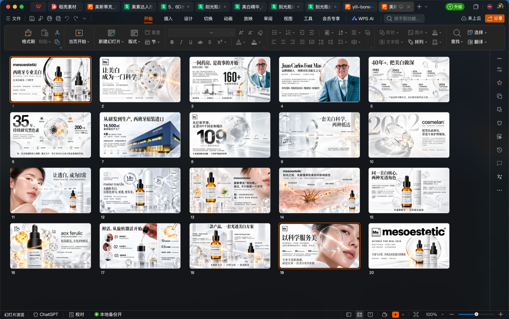</td>
  </tr>
  <tr>
    <td align="center"><sub>营养健康提案</sub></td>
    <td align="center"><sub>医美护肤提案</sub></td>
  </tr>
  <tr>
    <td width="50%">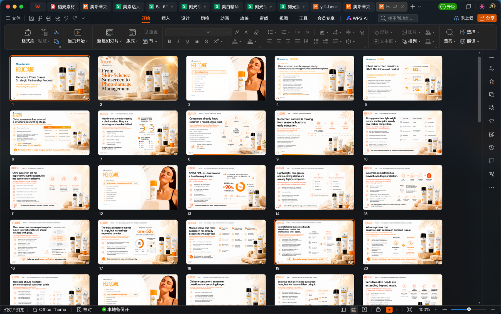</td>
    <td width="50%">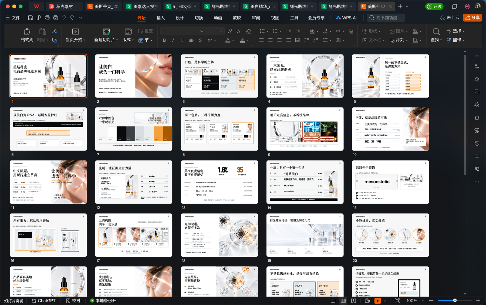</td>
  </tr>
  <tr>
    <td align="center"><sub>市场策略提案</sub></td>
    <td align="center"><sub>品牌视觉系统提案</sub></td>
  </tr>
</table>

同一份内容不会强塞进统一模板。系统先基于真实 Image2 样图给出 2–3 个拉开维度的视觉方向，由 Owner 选定后固化为 `DESIGN.md` 再逐页生产：

<table>
  <tr>
    <td width="33.3%">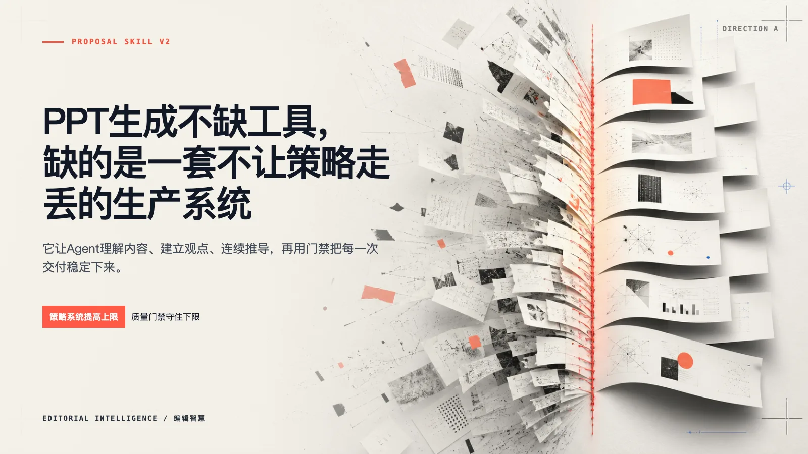</td>
    <td width="33.3%">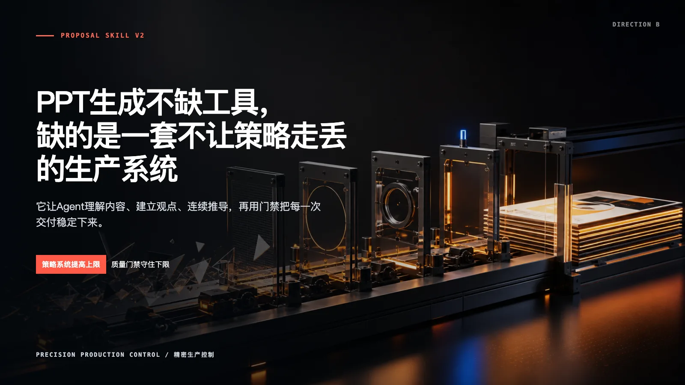</td>
    <td width="33.3%">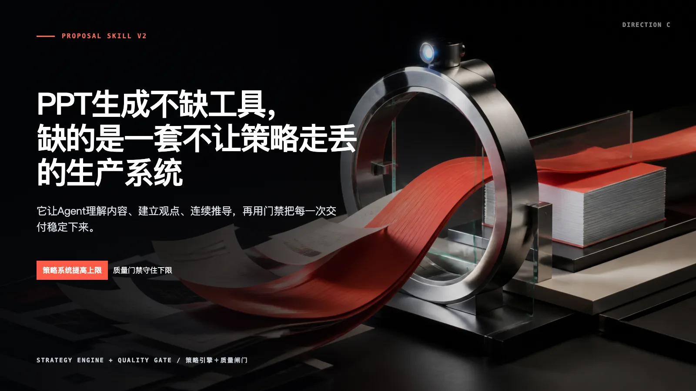</td>
  </tr>
  <tr>
    <td align="center"><sub>Editorial Intelligence</sub></td>
    <td align="center"><sub>Precision Control</sub></td>
    <td align="center"><sub>Strategy Engine + Quality Gate</sub></td>
  </tr>
</table>

---

<a id="presenter"></a>

## 离线 HTML 讲解台与分层动效（可选增强交付）

当全部正式页面定稿、终版讲稿生成且低级错误核对通过后，如果 Owner 选择 **HTML 作为最终演播形态**，系统加载 [`references/presenter-html-and-motion.md`](skills/qifei-proposal-v2/references/presenter-html-and-motion.md)，通过 [`scripts/build_presenter_html.py`](skills/qifei-proposal-v2/scripts/build_presenter_html.py) 编译出 **单文件 100% 离线讲解台**。动效层绝不反向篡改已冻结的文案、数据口径与产品包装。

<table>
  <tr>
    <td width="50%">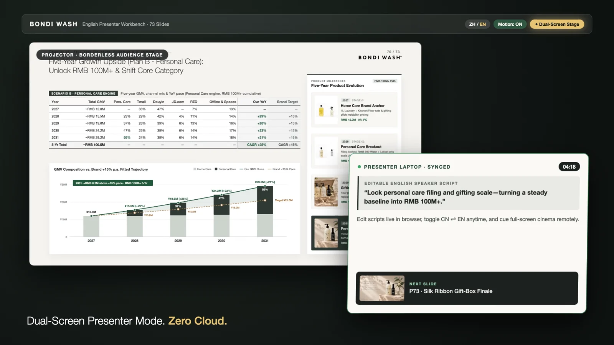</td>
    <td width="50%"></td>
  </tr>
  <tr>
    <td align="center"><sub><strong>双屏投屏演讲者模式（原生 file:// 直连）</strong><br>大屏显示纯净画面与动效，笔记本看下一页预告、计时器与可编辑双语讲稿</sub></td>
    <td align="center"><sub><strong>按情绪曲线编排的分层动效</strong><br>实景视频、互动直播窗、3D 展厅与数据聚焦，全部打进单个离线文件</sub></td>
  </tr>
</table>

### 动效分层框架与防翻车护栏

| 层级 | 适用页面 | 核心职责与标准做法 | 红线约束 |
|---|---|---|---|
| **基础层** | Hero 封面 / Ending 致谢 / 章节目录 / 页间切换 | 6–8s 固定机位氛围视频铺底 + 独立矢量文字层；目录轻扫光；200–340ms 克制切页 | 文字永不烧录进视频；禁用旋转、弹跳、百叶窗等廉价 PPT 转场 |
| **增强 A 档** | 情绪克制的多栏对比、排期与方法论页 | 用项目专属品牌母题沿列缝轻串联，缓解长文枯燥感 | 不遮挡正文，不做大面积高对比闪烁 |
| **增强 B 档** | 市场规模、价盘、渠道、财务测算等强逻辑数据页 | 渐进式曲线爬坡、关键拐点星标与差额高亮，锁定听众视线 | **严禁夸张特效**；不篡改数值与坐标比例 |
| **增强 C 档** | 母稿标明情绪高点的营销、直播、线下空间页 | 局部实景微动框、前后景抠图遮挡、互动演示窗、离线 3D 沙盘 | 必须服务具体讲解节拍；无故事线支撑直接降级 |

- **连续静页节奏护栏（Pacing Guardrail）**：脚本自动扫描整套页序——连续 `12–19` 页无动效触发提醒，连续 `≥ 20` 页触发强制补位建议，防止长演讲节奏掉线。
- **6 条防低能力模型翻车约束**：色盘锁死 `design-tokens.json`、缓动物理克制、单页唯一焦点、禁止模型手写低质具象 Canvas 插画（无视频能力宁简勿丑）、终帧可打印、零幽灵遮挡。
- **会议室兜底设计**：顶栏内置 `V` 键一键关闭动效，遇投影设备卡顿秒切 100% 纯净静态定稿；全案零外链、零云端、无需本地起服务。

```bash
# 从清单 JSON（含 slides 数组）打包离线双语讲解台（默认支持在线编辑讲稿；只读模式加 --no-edit-notes）
python3 skills/qifei-proposal-v2/scripts/build_presenter_html.py \
  --manifest <deck-spec.json> --langs zh,en --out exports/presenter.html
```

---

<a id="whats-new"></a>

## 核心协作工作台与质量体系

### 01 · 提案母稿工作台

母稿的唯一权威源。在浏览器里阅读、就地编辑、选中文字评论；Agent 直接改母稿文件，页面约半秒内热同步。Owner 逐章确认时记录每页内容指纹，之后任何修改都会让该章自动退回待确认。

<p align="center">
  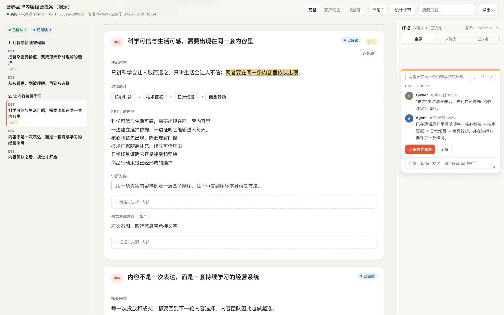
</p>

- 提供 **完整 / 客户视图 / 只读标题链 / 线框** 视图，数据多列表完整保留不丢列。
- 评论线程化闭环：Owner 提问 → Agent `draft_studio.py reply` 回复 → Owner 一键「同意并解决」，已决定意见保留为决策记录。
- `serve --detach` 常驻服务；不绑定飞书，飞书仍可在建项时选作权威源（[飞书用法教程](https://my.feishu.cn/docx/AegvdkYQ8odUetxOo8bcOCILn64)）。

### 02 · 设计评审：在渲染页面上框选评论

页面生产阶段，Owner 直接在渲染好的 16:9 页面上拖框写修改意见，不再截图或倒腾 JSON。

<p align="center">
  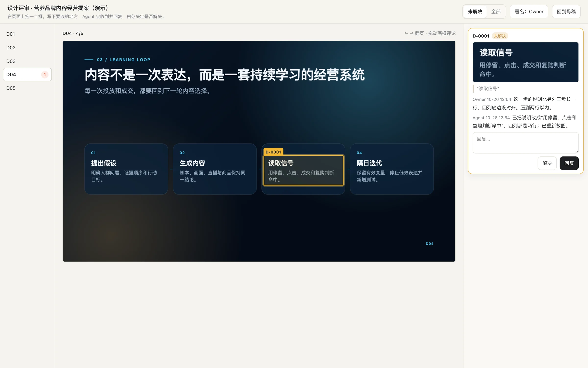
</p>

- 自动记录页面、截图哈希、1920×1080 坐标、框内文字与区域裁剪图。
- Agent 用 `design_review.py list` 读取修改并回复；只有 Owner 能标记解决，存在未解决评论的页面禁止进入拼装准备库。

### 03 · 三层提案记忆库

Owner 的判断跨项目沉淀为三层：**Owner 偏好 / 方法论 / 项目记忆**。换阶段时 Agent 从评论、改稿与确认记录中提炼候选，由 Owner 在记忆库采纳或丢弃，后续阶段开工自动注入并校验读取回执。

<p align="center">
  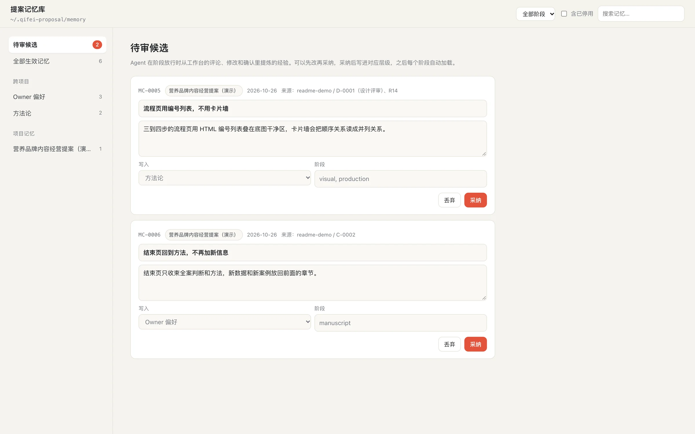
</p>

- 只需两个命令：`proposal_memory.py note` 随手记下更正，`proposal_memory.py advance --to <新阶段>` 一键汇总信号并加载新阶段记忆；不需要时可 `proposal_memory.py off` 全局关闭。

### 04 · 机器守住下限的硬门禁

| 检查项 | 拦住什么问题 |
|---|---|
| **批准人校验** | 门禁批准只认 Owner；Agent 不能自己批准，也不能豁免校验报错 |
| **`DESIGN.md` 内容校验** | 只有空标题没有具体数值（网格、字号表、Logo 槽位、安全区）的设计规范 |
| **上屏审慎用语拦截** | “不等于 / 不代表 / 仅供参考”等内部审慎说明外露到客户页面 |
| **上屏文字逐行比对** | 页面或 PPTX 上的字与冻结母稿不一致（缺字、多字、漏行） |
| **真实渲染版面实测** | 孤字尾行、溢出越界、文字压纹理、Logo 偏位、压住人脸或产品保护区 |
| **独立视觉对抗审查** | 另一个独立 Agent 逐页审查并绑定截图哈希 |
| **最终核对与节奏扫描** | 导出前核对页序、错别字与讲稿对齐；启用 HTML 动效时扫描连续静页跨度 |

完整迭代记录见 [`CHANGELOG.md`](CHANGELOG.md)。

---

<a id="pipeline"></a>

## 一条从想法到上台的受控生产链

```text
想法 / 标书 / 碎片资料
   │
   ├─ 01 关键决策访谈 ····· 受众、目标、立场、核心矛盾（grill-me-lite）
   ├─ 02 策略主轴 ········· 核心命题、章节接口、论证顺序（可选营销前置参考）
   ├─ 03 母稿成稿 ········· 整章生成 → 工作台框选评论修改 → Owner 逐章确认
   ├─ 04 全稿审查 ········· 独立 Agent 一次核查逻辑、拆页与审慎语言外露
   ├─    内容冻结
   ├─ 05 视觉方向 ········· 真实 Image2 样图 → Owner 选定 → DESIGN.md + tokens
   ├─ 06 设计校准 ········· 母版页、组件字号表、带字样张评审
   ├─ 07 页面生产 ········· 逐页选载体 → 整页 Image2 底图 + HTML 文字层（或视觉表现型整页生图）
   ├─    设计评审 ········· 渲染页框选评论 → Agent 修改 → Owner 解决 → 进入准备库
   ├─    独立视觉审查 ····· 真实渲染版面实测 + 独立 Agent 逐页核查
   ├─ 08 讲稿与终检 ······· 按最终页序一次生成讲稿 + 低级错误通读核对
   └─    多态交付 ········· PNG / 矢量 PDF / 半可编辑 PPTX / 离线 HTML 讲解台（可选分层动效）
```

| 阶段 | 脚本自动检查 | Owner 拍板确认 |
|---|---|---|
| **母稿** | 统一 `proposal-draft-v2` 格式、审慎用语、标题链、修订哈希 | 逐章 / 逐页确认 |
| **全稿审查** | 独立审查报告与编号完整性 | 内容冻结 |
| **视觉与校准** | 真实图像资产、官方产品参考图、`DESIGN.md` 与 `tokens` 数值校验 | 选定方向、批准校准 |
| **页面生产** | 页面合同、构建身份、上屏文字逐行一致、零未解决设计评论 | 逐页放行入库 |
| **视觉审查** | 版面实测零问题、独立审查覆盖全页且哈希一致 | — |
| **导出与演播** | 终检通过、讲稿页序一致、PPTX 比对；HTML 动效配置单与静页跨度扫描 | 批准配置单与最终交付 |

### 支持三种任务规模

| 模式 | 适用场景 | 保留的控制边界 |
|---|---|---|
| `full_deck` | 0–1 完整商业提案、品牌手册或汇报 | 完整策略、全稿审查、内容冻结、视觉校准、讲稿与多态交付 |
| `inherited_module` | 向已有受控方案新增或替换章节 | 继承父项目策略与设计系统，重点校验模块接口与页面质量 |
| `standalone_module` | 单页或 2–8 页独立专题模块 | 轻量访谈、核心判断、视觉基线、页面回环与导出 |

---

<a id="onboarding"></a>

## 第一次用：图文导览

装好之后对 Agent 说一句“用提案 skill 帮我做一份提案”，它会先讲清一共 8 步、哪 5 步需要你拍板，再打开一份图文导览：每一步 Agent 做什么、你要决定什么，配真实工作台样式的界面图。导览是单文件 HTML，中英双语，位于 [`skills/qifei-proposal-v2/assets/guide/onboarding.html`](skills/qifei-proposal-v2/assets/guide/onboarding.html)，下载后双击即可打开。

<p align="center">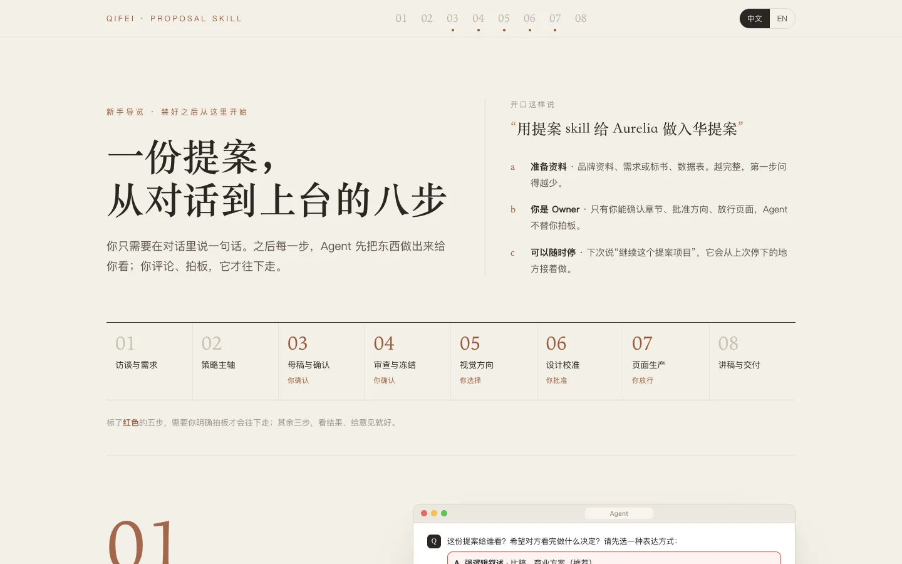 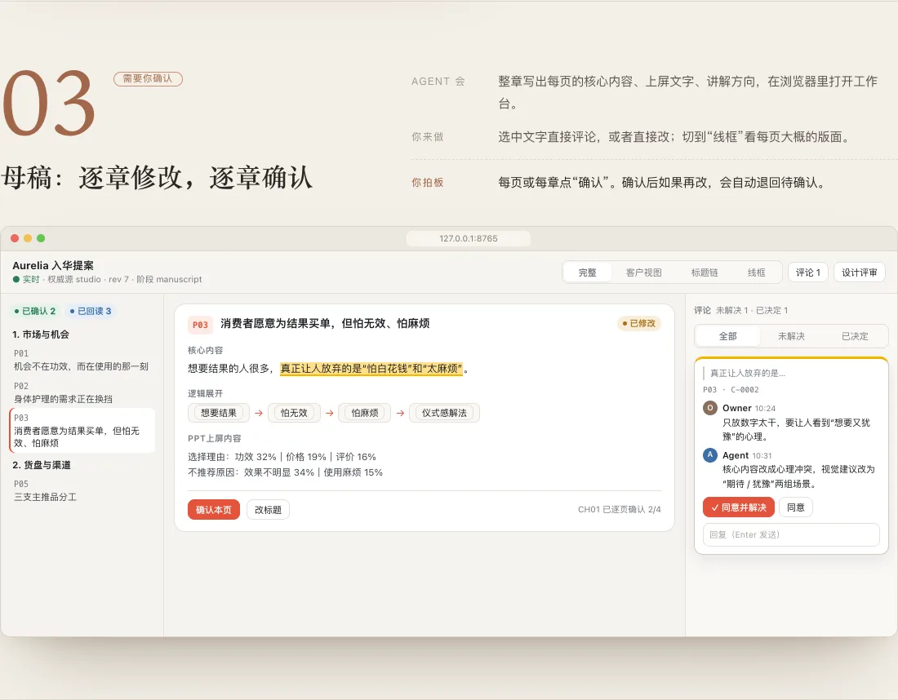</p>

<a id="quickstart"></a>

## 快速开始

### 1. 拉取仓库并初始化环境

```bash
git clone https://github.com/chenxupeng1990-eng/qifei-proposal-skill.git
cd qifei-proposal-skill
python3 scripts/bootstrap.py --suite v2
```

macOS 可直接双击 [`scripts/install_v2.command`](scripts/install_v2.command)，Windows 运行 [`scripts/install_v2.ps1`](scripts/install_v2.ps1)。

### 2. 安装 Skill 套件

```bash
python3 scripts/install_skills.py --suite v2
```

默认安装到 `~/.codex/skills`（已有同名目录会安全中止，确认覆盖加 `--force`）。重启 Agent 后调用 `$qifei-proposal-v2`（或 `/qifei-proposal-v2`）。

### 3. 体检、建项与打开工作台

```bash
# 检查当前本机与 Agent 能力档位
python3 skills/qifei-proposal-v2/scripts/doctor.py --task-mode full_deck --json

# 新建完整提案项目
python3 skills/qifei-proposal-v2/scripts/init_project.py \
  --project <项目目录> --name <项目名> --owner <Owner> --task-mode full_deck

# 启动母稿工作台（含 /design 框选评审页）与提案记忆库
python3 skills/qifei-proposal-v2/scripts/draft_studio.py serve <项目目录> --detach
python3 skills/qifei-proposal-v2/scripts/memory_box.py
```

Windows 中将 `python3` 替换为 `py -3` 或 `python`（运行自检：`python scripts/self_test.py`）；路径含中文或空格请加引号。

### 4. 自动检查更新

新版本发布后 Agent 开工时会提示（每天最多一次），说“更新提案 skill”即可无损更新（不触碰项目文件与记忆库，自检失败自动回滚）；也可手动执行：

```bash
python3 ~/.codex/skills/qifei-proposal-v2/scripts/update_skill.py run
python3 ~/.codex/skills/qifei-proposal-v2/scripts/update_skill.py off
```

---

<a id="runtime"></a>

## 运行档位与套件组成

不绑定特定模型或订阅。`doctor.py` 按真实可用能力自动定档，缺项明确列出补齐办法，绝不静默降级：

| 档位 | 适用环境与交付能力 |
|---|---|
| `codex_full` | 内置生图、看图、本地渲染与评论齐全，支持端到端完整生产 |
| `api_full` | 任意支持文件、命令、图像 API 与视觉理解的 Agent，同样支持完整生产 |
| `local_production` | 支持本地渲染、评审与导出；缺正式生图能力时不可绕过视觉方向门禁 |
| `content_only` | 输出策略、母稿、页面路由与提示词包，不冒充视觉或成品交付 |

| Skill | 职责 | 安装级别 |
|---|---|---|
| `qifei-proposal-v2` | 总控入口：阶段、状态、门禁、母稿工作台、记忆库、离线 HTML 讲解台 | 必装 |
| `grill-me-lite` | 一次一个问题的关键决策访谈 | 必装 |
| `proposal-ppt-production` | 页面载体选择、视觉生产与组装 | 推荐 |
| `ppt-html-calibration-editor` | 16:9 HTML 页面的像素级校准编辑器 | 可选 |

### 四种交付形态

- **基础交付**：审定 PNG、矢量 PDF（`exports/proposal-vector.pdf`，文字可选中放大不糊）、图片型 PPTX。
- **增强交付**：带 PowerPoint 原生文字层的半可编辑 PPTX，与母稿逐行核对一致。
- **视觉表现型路线**：支持品牌手册、画册类整页直接生图（`render_route: image_full`）与图文核对。
- **离线 HTML 讲解台（可选）**：单文件离线演播、双语切换、可编辑讲稿、双屏投屏与分层动效。

<details>
<summary><strong>核心治理规则</strong></summary>

- 准确是边界，观点和决策推动是目标；正确但没有观点的页面要退回。
- 上屏只放观点、证据和来源；边界写进措辞本身，内部审慎说明放讲稿或证据台账。
- 总策略先编译为章节接口，再编译为页面论证链；上一章的输出必须成为下一章的输入。
- 页面论证链确认后一次生成整章正文，再逐页评论和确认。
- 全部内容确认后只做一次全稿审查，不重新审判 Owner 已确认的场外决策。
- 正式视觉前必须有真实图像资产参与方向校准；默认路线是整页 Image2 底图加 HTML 文字层。
- 讲稿等全部页面和最终页序确认后一次生成；HTML 动效只在定稿与终检通过后叠加。

</details>

<details>
<summary><strong>公司资料与项目隔离</strong></summary>

默认的 `company-facts.json` 只是空模板。真实使用前请在私有项目中登记核准事实。客户资料、品牌资产、评审页面与交付物均保存在各自项目目录；记忆位于 `~/.qifei-proposal/memory/`。本仓库仅包含通用规则、模板、脚本、测试与脱敏 Demo。

</details>

<details>
<summary><strong>仓库目录结构</strong></summary>

```text
skills/qifei-proposal-v2/               总控 Skill：阶段包、参考规范、模板、脚本与测试
  ├─ references/presenter-html-and-motion.md  离线 HTML 讲解台、双屏投屏与分层动效规范
  ├─ scripts/draft_studio.py            母稿工作台与 /design 框选评审页
  ├─ scripts/memory_box.py              三层提案记忆库
  ├─ scripts/build_presenter_html.py    单文件离线 HTML 讲解台打包与静页节奏扫描
  └─ scripts/validate_project.py        阶段与交付门禁
skills/grill-me-lite/                   关键决策访谈
skills/proposal-ppt-production/         页面生产与组装
skills/ppt-html-calibration-editor/     HTML 校准编辑器
demo/visual-sample/                     脱敏视觉 Demo
scripts/                                安装、Bootstrap 与发布自检
docs/readme-assets/                     本页视频、动图与界面展图
```

</details>

---

## 当前状态

最新进展持续更新在 [`codex/qifei-proposal-base`](https://github.com/chenxupeng1990-eng/qifei-proposal-skill/tree/codex/qifei-proposal-base)（基线版本 `v0.3.2`，已合入 `v0.3.3` 预研能力：离线 HTML 讲解台、原生双屏投屏、分层动效规范与节奏护栏）。当前 **244 项 Python 单元测试（核心 239 + 安装自检 5）全部通过**。欢迎用真实提案任务实测并提 Issue。

<a id="license"></a>

## 使用与授权

本仓库**不是无限制开源，也不授予商业使用权**。默认仅允许个人学习、研究、测试和非商业内部评估使用。

- 协议文本见 [`LICENSE`](LICENSE)（PolyForm Noncommercial License 1.0.0）。
- 商业使用、团队部署、对外提案服务、二次分发或闭源集成，请先联系作者获取书面商业授权。
